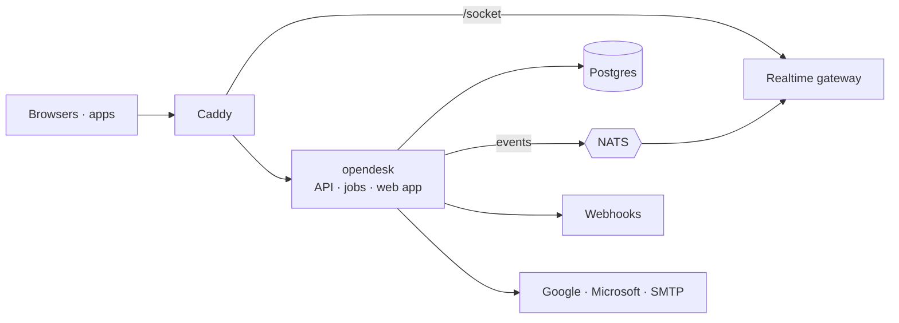

<div align="center">
  <picture>
    <source media="(prefers-color-scheme: dark)" srcset="brand/logo/lockup-white.svg">
    
  </picture>

  <p>The open-source helpdesk.</p>

  <p>
    <a href="https://opendesk.sh"></a>
    <a href="https://docs.opendesk.sh"></a>
    <a href="https://github.com/useopendesk/opendesk/actions/workflows/ci.yml"></a>
    <a href="./LICENSE"></a>
    <a href="https://dc.opendesk.sh"></a>
    <a href="https://x.opendesk.sh"></a>
  </p>

  <p>
    <a href="#features">Features</a> ·
    <a href="#how-it-works">How it works</a> ·
    <a href="#quick-start">Quick start</a> ·
    <a href="#self-hosting">Self-hosting</a> ·
    <a href="#documentation">Docs</a> ·
    <a href="#community">Community</a> ·
    <a href="#support">Support</a>
  </p>

  <p><i>⭐ Help more teams find opendesk. Star this repo!</i></p>
</div>

<p align="center">
  
</p>

## opendesk

opendesk brings your support email, live chat and help center into one shared
inbox, and every change shows up live for everyone on the team. It ships as a
hosted service at [opendesk.sh](https://opendesk.sh) and as a self-hosted
install, and **the two run the same code**. Ollie, the built-in AI, drafts,
triages and answers alongside your team, with any Anthropic or OpenAI-compatible
provider, including local models.

## Features

- **Shared inbox** - tickets with status, priority, assignee, team, tags and SLA; notes, merge, snooze, bulk edit
- **Mailboxes** - forward your support address in, reply from it through Google, Microsoft or SMTP
- **Live chat** - an embeddable widget with identity verification, typing and live delivery
- **Knowledge base** - collections and articles, published to a public help center
- **Ollie and bots** - drafts, summaries, triage, translation and chat answers from your knowledge base
- **Automations and SLAs** - rules that run on ticket events, and targets per priority
- **Reports and CSAT** - volume, response and resolution times, breaches and satisfaction
- **Integrations** - Linear, GitHub, Jira, Sentry, Slack, Stripe and any MCP server
- **Public API** - the REST API the app itself uses, plus signed webhooks, a realtime socket and MCP
- **Apps** - desktop for macOS, Windows and Linux, and a native iPhone app

## How it works

opendesk is one Go binary (the API, background jobs and the event relay), an
Elixir realtime gateway that holds no database connection, and Postgres. Every
change that someone else should see is written as an event in the same
transaction as the change; the relay publishes it to NATS, the gateway pushes it
to browsers, and webhooks deliver it to your endpoints. There is no Redis and no
Kafka.



Self-hosted, NATS runs embedded in the opendesk binary and the whole stack sits
behind Caddy on one domain. The hosted service splits the same binary into API
and worker roles. Full write-up in the
[introduction](https://docs.opendesk.sh/getting-started/introduction/) and the
[cloud architecture](https://docs.opendesk.sh/cloud/architecture/).

## Quick start

You need Go, Node.js with pnpm, Elixir, and Docker for Postgres.

```bash
git clone https://github.com/useopendesk/opendesk && cd opendesk
cp .env.example .env
make dev-db      # Postgres on localhost:55432
make api         # the Go API and workers, with embedded NATS on :4222
make realtime    # the Elixir gateway on :4000
make web         # the web app on :5173
```

Open `http://localhost:5173` and sign up. Until you configure a mail driver,
verification and invitation emails are printed to the API log. `make site` and
`make docs` run the marketing site and the docs. More in the
[contributing guide](https://docs.opendesk.sh/contributing/).

## Self-hosting

<a href="https://docs.opendesk.sh/self-hosting/"><img src="https://img.shields.io/badge/Ru