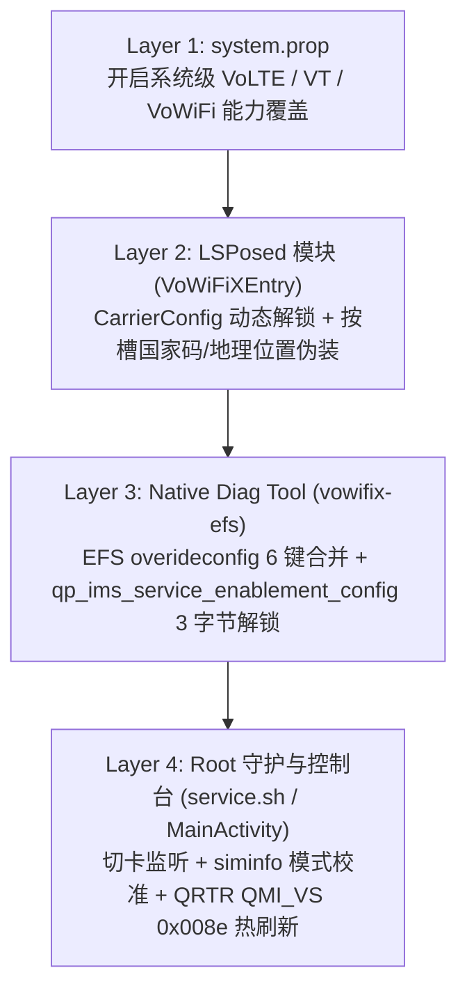

# VoWiFiX

原生基带 VoWiFi（Wi-Fi Calling）与跨国漫游全栈增强方案（高通骁龙平台）。

VoWiFiX 将 **Root 基带 EFS 层工具**（`vowifix-efs` + 切卡自动守护）与 **LSPosed 框架增强 + 极简原生控制台 App**（`~100 KB`，零第三方依赖）结合为一体化工程：在不改写运营商原始 `MBN` 镜象文件的前提下，从属性层、Android IMS/框架层、高通基带 EFS 与 `siminfo` 持久层四个维度打通跨运营商、跨卡热切换与国际漫游下的原生 VoWiFi 能力。

---

## 核心特性

- **双层基带 EFS 安全合并与漫游解锁**
  - 原生支持高通传统 `/dev/diag` (`diagchar`) 与 GKI 新平台 `diag-router`（`AF_UNIX` `SOCK_SEQPACKET`）双后端自动探测（`EFS2_DIAG_*`），对 `/efsprofiles/overideconfig`（及双卡副槽 `_Subscription01`）执行只增不毁、逐字节校验的 `6` 键通用配置合并，保留各卡原有 APN/端口/加密策略不变；
  - 同步对活跃槽位 `/nv/item_files/ims/qp_ims_service_enablement_config` 执行最小 `3` 字节解锁（启用 Wi-Fi 通话总开关、将移动网络优先改回 Wi-Fi 优先、解除漫游强制禁用 VoWiFi），并对存在静态 `<fqdn>` 但原厂关闭开关的 `/data/iwlan_s2b_config.xml`（及副槽 `_Subscription01`）执行 XML 注释感知静态 FQDN 解锁，打通如香港 3HK 等依赖静态 ePDG 域名的运营商；
- **跨卡热切换免重启自适应**
  - 常驻守护进程监听双卡 `gsm.sim.state` 与 `MCC/MNC` 变动，在切卡或漫游就绪后自动完成 EFS 合并、`telephony/siminfo` 历史策略校准，并通过 Qualcomm `QRTR` (`AF_QIPCRTR`) 按变更卡槽下发 `QMI_VS` 订阅绑定（`0x0021`）+ `0x008e` 独立/双槽热刷新（热插副卡时不打断主卡在线状态），无需重启即可生效；
  - 自 `v1.0.1` 起引入多后端 Diag 传输层抽象与无副作用探测（`vowifix-efs detect`）：单文件静态二进制即可自动适配旧平台 `/dev/diag` 与骁龙 8 Gen 2 / 8 Gen 3 / 8 Elite 等 GKI 新平台的 `diag-router`；对极少数完全封禁 Diag 的商用 ROM 也会优雅切换至“上层解锁 + `siminfo` 校准 + QRTR 刷新”模式，消除开机等待超时与报错刷屏。
- **LSPosed 全作用域解锁与按槽伪装**
  - 绕过系统/ColorOS `CarrierConfig` 开关隐藏、Entitlement/Provisioning 云端资格校验，强制 `WIFI_PREFERRED`、`EPDG_ADDRESS_PLMN` 与 `{0, 1}` 地址优先级（静态配置优先、PLMN 回退）；开启 `wfc_carrier_name_override_by_pnn_bool` 与双架构归属运营商名防空兜底，修复无 `EF_SPN` 卡在漫游 VoWiFi 下显示驻留基站名称的问题；
  - 按卡槽自适应返回 SIM 归属 ISO 国家码并拦截基站/Wi-Fi PANI/CNI/地理位置上报（同时保留真实 `NITZ` 时区判定不受干扰）。
- **轻量原生控制台与快捷磁贴（`~100 KB`）**
  - 纯 Java 17 + Android 原生 View 零三方库实现，支持系统浅色/深色主题自适应与 Edge-to-Edge 安全区适配；
  - 内置框架激活自检、后台守护开关、双卡与 EFS 状态诊断（支持 AOSP 跨 ROM 通用 IMS 探测，兼容魅族 Flyme、小米 HyperOS 等非 ColorOS 机型，并细分无蜂窝驻网三态漫游显示）、一键热适配（含 `6s` 落盘倒计时）、原始备份一键还原、系统 `RadioInfo` 直达、控制中心快捷磁贴与桌面图标隐藏/恢复；
  - 未授予 Root 时自动降级为只读状态监控模式，绝不越权或强行提权。

---

## 为什么部分 SIM 卡或国际漫游拉不起 VoWiFi？

在实际使用不同运营商卡或出境漫游时，往往会遇到“同一台手机插 A 卡能秒出 VoWiFi，插 B 卡却始终停留在 VoLTE 或无反应”。通常存在四重叠加障碍：

1. **系统 `CarrierConfig` 与资格校验拦截**：系统未对冷门或境外运营商下发 `carrier_wfc_ims_available_bool` 等开关，或受 `carrier_wfc_provisioning_required_bool` / OEM 定制开关隐藏限制。
2. **定位与国家码泄露（Geo / PANI / CNI）**：部分运营商严格限制境外 IP / 非本土基站 PANI 与地理位置注册 VoWiFi，且 Android 多处定位服务（`LocaleTracker`、`CountryDetector`、Qualcomm CNE、IMS Geolocation）会将漫游所在国传给基带与 ePDG。
3. **高通基带 EFS 漫游硬锁与底层配置缺失**：
   - 不少运营商原厂 `mcfg_sw.mbn` 在 `/nv/item_files/ims/qp_ims_service_enablement_config`（1024 B）中写入了 **移动网络优先（`offset 0x09 = 0x03`/`0x04`）** 及 **漫游下强制禁用 VoWiFi（`offset 0x0D = 0x02`）**；
   - 高通原生 `ImsConfigImpl` 在源码层还会对漫游开关请求（`item == 26`）直接忽略并由基带本地决策接管，导致纯改 Android 上层无效。
4. **`telephony/siminfo` 历史策略锁定**：切换回曾经在本地“移动优先”状态下用过的 SIM 卡时，系统数据库残留的 `wfc_ims_mode=1` / `wfc_ims_roaming_mode=1`（或 `-1`）会覆盖新的 `CarrierConfig` 默认值。

---

## 四层协同架构

### 各层精准作用细节

| 层级 | 组件 / 目标路径 | 具体作用 |
| :--- | :--- | :--- |
| **Layer 1** | `root-module/system.prop` | 注入 `persist.dbg.ims_volte_enable=1`、`volte_avail_ovr=1`、`vt_avail_ovr=1`、`wfc_avail_ovr=1`。 |
| **Layer 2** | `CarrierConfigHook` | 在 `OplusCarrierConfigLoader` / `CarrierConfigLoader`、`CarrierConfigManager` 及 `ImsManager` 中开启 `editable_wfc_*`、去 Entitlement 校验、强制 `WIFI_PREFERRED (2)`、`EPDG_ADDRESS_PLMN (1)` 与 `{0, 1}` 地址优先级、ColorOS 显示键及 `wfc_carrier_name_override_by_pnn_bool`，并在 `IccRecords` 与 `CarrierDisplayNameResolver` 注入归属运营商名称防空兜底。 |
| **Layer 2** | `LocationGeoHook` / `CountrySpoofer` | 为启用了 VoWiFi 伪装的卡槽统一覆盖 `TelephonyManager`、`LocaleTracker`（保护 `NITZ` 自动时区）、`CountryDetector`、高通 `ImsSenderRxr`/`ImsServiceSub` Geolocation 及 `com.qualcomm.qti.cne` 国家码，返回卡归属国家 ISO。 |
| **Layer 3** | `/efsprofiles/overideconfig` (`_Subscription01`) | `vowifix-efs` 仅合并 `[ILS:IlsGeoLocImsWlan]` 4 项优先级/国家码覆盖键与 `[SIPConfig:GeoLocation]` `iEnableCellInfoInPANI=0`、`[SIPConfig:FeatureFlags]` `IsCNIEnabled=0`。 |
| **Layer 3** | `/nv/item_files/ims/qp_ims_service_enablement_config` | `vowifix-efs` 在不改变 `1024 B` 结构的前提下仅做最小 3 字节解锁：`0x08 != 0x01 -> 0x01`（总开关）、`0x09 ∈ {0x00,0x03,0x04} -> 0x01`（Wi-Fi 优先）、`0x0D == 0x02 -> 0x01`（解除漫游封锁）。 |
| **Layer 3** | `/data/iwlan_s2b_config.xml` (`_Subscription01`) | `vowifix-efs` 采用 XML 注释感知匹配，仅对原厂已配置静态 `<fqdn>` 但关闭开关的槽位将 `<static_fqdn_enabled>FALSE</static_fqdn_enabled>` 改为 `TRUE`，无静态 `<fqdn>` 的槽位自动跳过。 |
| **Layer 4** | `service.sh` / `MainActivity` | 尊重用户意图（仅当 `wfc_ims_enabled != 0` 且模式为 `1`/`-1` 时校准 `siminfo` 为 `2`），通过 `QRTR` 触发 `QMI_VS` `0x008e` 免重启重载，并提供跨 ROM 通用 IMS 探测与无蜂窝三态漫游显示。 |

---

## 环境要求

- **芯片平台**：搭载高通骁龙基带的设备（原生支持 `/dev/diag` 与无 `/dev/diag` GKI 新平台 `diag-router` 双后端自动探测；未开放任意 Diag 通道时自动降级为上层解锁 + 